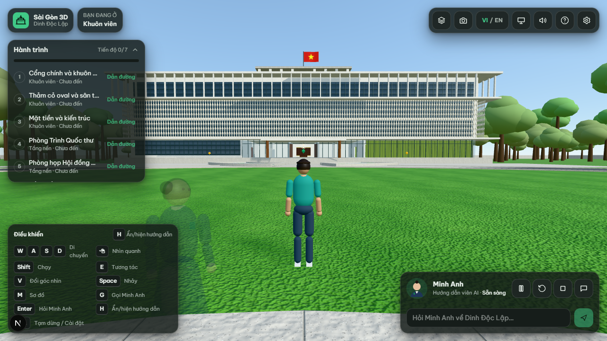
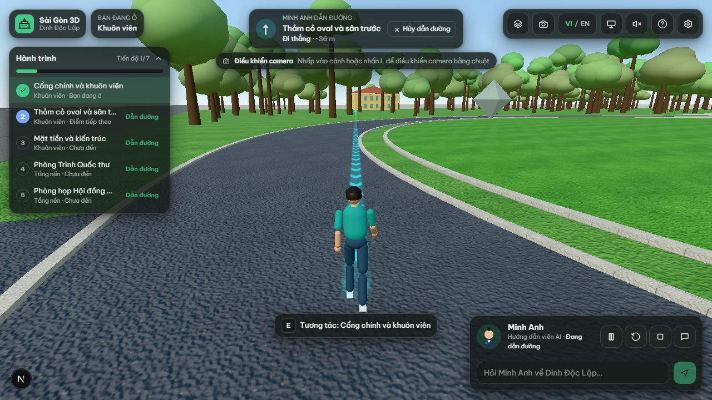
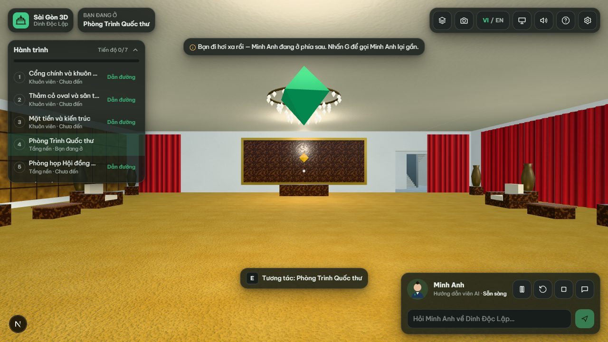
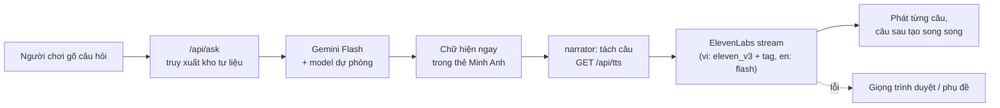

<div align="center">

# 🏛️ Sài Gòn 3D — Du lịch số di sản

**Saigon 3D — Immersive Heritage Explorer**

Bản đồ Sài Gòn 3D dựng từ dữ liệu OpenStreetMap thật, và chuyến tham quan **Dinh Độc Lập** có thể đi bộ,
với hướng dẫn viên AI **Minh Anh** dẫn đường, thuyết minh song ngữ và trả lời câu hỏi dựa trên tư liệu đã kiểm chứng.

[](https://nextjs.org)
[](https://react.dev)
[](https://threejs.org)
[](https://www.typescriptlang.org)
[](https://ai.google.dev)
[](https://elevenlabs.io)
[](#-kiểm-thử)
[](https://www.openstreetmap.org/copyright)

[Tính năng](#-tính-năng) · [Ảnh chụp](#-ảnh-chụp) · [Cài đặt](#-cài-đặt-nhanh) · [Cấu hình AI & giọng nói](#-cấu-hình-ai--giọng-nói) · [Kiến trúc](#-kiến-trúc) · [Triển khai](#-triển-khai) · [Độ chính xác](#-độ-chính-xác-lịch-sử)

</div>

---

## 📖 Giới thiệu

**Sài Gòn 3D** là ứng dụng web du lịch số cho di sản TP. Hồ Chí Minh:

- **Bản đồ thành phố 3D** khu trung tâm (Quận 1) dựng tự động từ OpenStreetMap: đường phố, sông Sài Gòn, kênh Bến Nghé, công viên và khoảng 2.400 công trình, cùng xe cộ, thuyền, người đi bộ và chim được mô phỏng.
- **Dinh Độc Lập đi bộ được**: khuôn viên, mặt tiền với rèm hoa đá, đại sảnh, Phòng Trình Quốc thư, Phòng họp Nội các, tầng hầm và sân thượng, có va chạm vật lý.
- **Minh Anh, hướng dẫn viên AI** là một nhân vật trong thế giới 3D: đi trước dẫn đường, dừng chờ khi bạn tụt lại, thuyết minh có phụ đề và giọng nữ tiếng Việt/Anh, và trả lời câu hỏi bằng Gemini dựa trên kho tư liệu có nguồn.

> **Trạng thái:** MVP. Dinh Độc Lập là điểm được đầu tư hoàn chỉnh; các địa danh khác trên bản đồ ở trạng thái “Sắp ra mắt”.

## ✨ Tính năng

| | |
|---|---|
| 🗺️ **Bản đồ 3D từ dữ liệu thật** | Hình học đường, sông, công viên, công trình từ OSM; kiến trúc sinh tự động theo diện tích/chiều cao; dựng trong Web Worker |
| 🚦 **Thành phố sống động** | 8 loại xe chạy theo chiều `oneway` thật, dừng đèn đỏ ở giao lộ; tàu thuyền trên sông và kênh; người đi bộ, chó, mèo, chim; 3 mức chất lượng và LOD |
| 🏛️ **Dinh Độc Lập chi tiết** | Texture PBR sinh bằng mã, rèm hoa đá dựng bằng hình học thật, nội thất các phòng theo ảnh chính thức, ánh sáng dịu dần khi vào/ra nhà |
| 🚶 **Điều khiển kiểu game** | WASD, chạy, nhảy, góc nhìn thứ nhất/thứ ba; khóa chuột (Pointer Lock); dáng đi khớp vận tốc, chân không trượt; hỗ trợ cảm ứng |
| 🧭 **Dẫn đường** | Chọn điểm đến (điểm dừng, hiện vật, phòng) → dải sáng bám sàn đi qua cửa và cầu thang hợp lệ, không xuyên tường; khoảng cách và chỉ dẫn rẽ trái/phải/lên/xuống |
| 👩‍🏫 **Minh Anh dẫn đoàn** | Đi trước 2–4 m, chậm lại và chờ khi bạn tụt lại, nhắc bằng lời (không lặp liên tục), thuyết minh khi bạn đến gần, tạm dừng khi bạn đi xa |
| 🤖 **Hỏi đáp AI** | Gemini Flash trả lời **chỉ từ kho tư liệu có nguồn**, đúng ngôn ngữ bạn đang gõ, nhớ ngữ cảnh nhiều lượt; thiếu khóa hoặc lỗi thì trả lời trích từ kho (ghi rõ chế độ demo/dự phòng) |
| 🔊 **Giọng nói ElevenLabs** | Giọng nữ tiếng Việt có biểu cảm (`eleven_v3` + audio tag chọn lọc) và giọng nữ tiếng Anh độ trễ thấp (`eleven_flash_v2_5`), stream theo từng câu; lỗi thì tự lùi về giọng trình duyệt hoặc phụ đề |
| 🌐 **Song ngữ & tiếp cận** | Tiếng Việt / English, giao diện sáng/tối, đổi phím, giảm chuyển động, phụ đề |

## 📸 Ảnh chụp

| Mặt tiền và rèm hoa đá | Minh Anh thuyết minh ở cổng |
|---|---|
|  |  |
| **Dải dẫn đường trên đường vòng** | **Phòng Trình Quốc thư** |
|  |  |
| **Phòng họp Hội đồng Nội các** | |
|  | |

<sub>Ảnh chụp từ ứng dụng (chế độ chất lượng thấp/trung bình, trình duyệt headless).</sub>

## 🚀 Cài đặt nhanh

**Yêu cầu:** Node.js ≥ 20 (đã kiểm tra trên Node 24) · trình duyệt hỗ trợ WebGL 2.

```bash
git clone https://github.com/huynh-phong/3D-Digital-Tourism.git
cd 3D-Digital-Tourism
npm install

cp .env.example .env    # điền GEMINI_API_KEY và ELEVENLABS_API_KEY
npm run dev             # http://localhost:3000
```

Không có khóa API ứng dụng vẫn chạy (**chế độ demo**): câu trả lời lấy từ kho tư liệu, giọng đọc dùng giọng trình duyệt hoặc phụ đề.

| Lệnh | Mô tả |
|---|---|
| `npm run dev` | Chạy môi trường phát triển |
| `npm run build` / `npm start` | Build và chạy production |
| `npm test` | Kiểm thử (vitest) |
| `npm run lint` · `npm run typecheck` | ESLint · TypeScript |
| `npm run data:osm` | Tải lại dữ liệu OSM → `public/data/city.json` (cache ở `scripts/.osm-cache/`) |

## 🔑 Cấu hình AI & giọng nói

Sao chép `.env.example` thành `.env` (hoặc `.env.local`). Khóa chỉ được đọc phía server, không bao giờ gửi xuống trình duyệt. File `.env*` đã được `.gitignore` chặn.

| Biến | Mặc định | Dùng cho |
|---|---|---|
| `GEMINI_API_KEY` | — | Hỏi đáp AI bằng Google Gemini (lấy tại [Google AI Studio](https://aistudio.google.com/apikey)) |
| `GEMINI_MODEL` | `gemini-2.5-flash` | Model chính |
| `GEMINI_FALLBACK_MODELS` | `gemini-flash-latest` | Model dự phòng khi model chính quá tải / 429 / quá thời gian (phân tách bằng dấu phẩy) |
| `AI_PROVIDER` | tự động | Ép chọn `gemini` hoặc `anthropic` |
| `ANTHROPIC_API_KEY`, `AI_MODEL` | — | Lựa chọn thay thế: Claude |
| `ELEVENLABS_API_KEY` | — | Giọng nói ElevenLabs (cần quyền *Text to Speech*; quyền *Voices: read* để tra voice ID) |
| `ELEVENLABS_VOICE_ID_VI` | `XrExE9yKIg1WjnnlVkGX` (Matilda) | Giọng nữ đọc tiếng Việt. Giọng “Trang – Clear, Smooth and Direct” là `BlZK9tHPU6XXjwOSIiYA` (giọng Voice Library, cần gói trả phí khi gọi qua API) |
| `ELEVENLABS_VOICE_ID_EN` | `EXAVITQu4vr4xnSDxMaL` (Sarah) | Giọng nữ tiếng Anh |
| `ELEVENLABS_MODEL_VI` / `ELEVENLABS_MODEL_EN` | `eleven_v3` / `eleven_flash_v2_5` | Model có audio tag biểu cảm / model độ trễ thấp |
| `TTS_PROVIDER` | `elevenlabs` | `elevenlabs` · `azure` · `google` |
| `AZURE_SPEECH_KEY`, `AZURE_SPEECH_REGION`, `GOOGLE_TTS_API_KEY`, `TTS_VOICE_VI`, `TTS_VOICE_EN` | — | TTS khác (tùy chọn) |

**Luồng hội thoại**



- Minh Anh trả lời bằng **ngôn ngữ bạn đang gõ** và chọn giọng tương ứng.
- **Biểu cảm tiếng Việt** (`lib/server/expressive.ts`): chỉ bản văn gửi tới TTS mới được gắn tag, chữ hiển thị luôn sạch và nội dung không bị sửa. Tag dùng có chọn lọc: câu chào → `[cheerfully]`, câu hỏi → `[curious]`, chi tiết nổi bật → `[excited]`, sự kiện đau thương → `[softly]`; không lặp tag ở hai câu liền nhau, không chèn tiếng cười, thở dài hay hiệu ứng. Tiếng Anh đọc tự nhiên, không tag.
- Câu hỏi mới dừng ngay âm thanh cũ, không bao giờ phát chồng.
- Không lưu hội thoại hay file âm thanh; server chỉ giữ vài câu trong bộ nhớ đệm.
- `/api/ask` và `/api/tts` có giới hạn tần suất và kiểm tra dữ liệu đầu vào (zod).

## 🎮 Điều khiển

| Phím | Chức năng |
|---|---|
| <kbd>W</kbd> <kbd>A</kbd> <kbd>S</kbd> <kbd>D</kbd> / mũi tên | Di chuyển (đi 3 m/s) |
| <kbd>Shift</kbd> | Chạy (5,5 m/s) |
| Chuột | Nhìn quanh — nhấp vào cảnh hoặc <kbd>L</kbd> để khóa chuột; không khóa thì giữ và kéo |
| <kbd>Esc</kbd> | Đang khóa chuột: mở khóa (game vẫn chạy) · Con trỏ đã mở: tạm dừng / cài đặt |
| <kbd>E</kbd> | Tương tác / đóng bảng thông tin |
| <kbd>V</kbd> | Góc nhìn thứ nhất ↔ thứ ba |
| <kbd>Space</kbd> | Nhảy |
| <kbd>M</kbd> | Sơ đồ tầng & chọn điểm đến |
| <kbd>G</kbd> | Gọi Minh Anh lại gần |
| <kbd>Enter</kbd> | Hỏi Minh Anh |
| <kbd>H</kbd> | Ẩn/hiện hướng dẫn |

Mọi phím (trừ Esc) đổi được trong Cài đặt. Thiết bị cảm ứng có cần điều khiển ảo.

## 🧱 Kiến trúc

**Công nghệ:** Next.js 16 (App Router) · React 19 · Three.js + React Three Fiber + drei · Rapier (vật lý, character controller) · Zustand · Framer Motion · Tailwind CSS 4 · zod · Vitest · ElevenLabs API.

```
app/                 Trang: / (bản đồ), /dinh-doc-lap (tham quan), /sources · API: /api/ask, /api/tts, /api/status
components/
  map/               CityScene, CityLayers (nhà, mặt đất, cây, mặt trời), LivingCity (xe, thuyền, người, chim)
  game/              DinhScene (Canvas + Rapier), Palace (render + vật liệu), RouteGuide (dải dẫn đường, marker), DinhExperience (HUD)
  player/            Player (character controller, camera), Humanoid (nhân vật & hoạt ảnh bằng mã)
  guide/             GuideNPC (Minh Anh trong thế giới 3D), GuideCard (hội thoại, phụ đề)
  tour/              StopList, InfoPanel, FloorMap, NavHud, Overlays
data/                dinh/ (sources, knowledge, tour, layout) · landmarks · i18n (vi/en) · assets (giấy phép)
lib/
  city/              buildCity (worker), roads, architecture, textures, geom
  sim/               traffic, water, life, models, config (LOD)
  dinh/              palaceModel (hình + collider + đồ thị đi bộ từ một nguồn), route (tìm đường), textures (PBR thủ tục)
  guide/brain.ts     Máy trạng thái của Minh Anh
  tour/              director, navigator, destinations
  server/            ai.ts (Gemini / Claude), tts.ts (ElevenLabs / Azure / Google), expressive.ts (tag biểu cảm), rateLimit
  audio/narrator.ts  Phát theo câu, phụ đề đồng bộ, tự hạ cấp giọng đọc
scripts/fetch-osm.mjs  Tải & tiền xử lý OSM
tests/               vitest
```

**Nguyên tắc thiết kế**

- **Một nguồn dữ liệu cho hình, va chạm và đường đi.** `lib/dinh/palaceModel.ts` sinh khối hiển thị, collider Rapier, đồ thị đi bộ và vật cản (kể cả nội thất) từ `data/dinh/layout.ts`. Người chơi, Minh Anh và bộ tìm đường vì vậy nhìn thấy cùng một thế giới.
- **Kiến thức nằm trong dữ liệu.** Mỗi câu thuyết minh dựa trên một `Fact` có nguồn và mức tin cậy (`verified` / `estimated` / `simulated` / `conflicting`).
- **AI bị ràng buộc vào kho tư liệu.** Mô hình chỉ được trả lời từ phần tư liệu truy xuất kèm theo; dữ kiện mâu thuẫn được nêu rõ là mâu thuẫn.
- **Hành vi tách khỏi hiển thị.** Tìm đường (`route.ts`) và quyết định của Minh Anh (`brain.ts`) là mã thuần, được kiểm thử độc lập.

<details>
<summary><b>Minh Anh — máy trạng thái</b></summary>

`WAITING` → `LEADING` → (bạn tụt lại hơn ~6 m) `CHECKING_DISTANCE` → `WAITING_FOR_PLAYER` → (hơn ~8 m) `REMINDING` → (bạn đến trong ~3,6 m) `RESUMING` → `LEADING` → đến điểm dừng → `EXPLAINING` (khi bạn ở gần; tạm dừng nếu bạn đi xa) → `WAITING`. Ngoài ra còn `LISTENING` khi bạn mở hộp hỏi đáp và `FOLLOWING` ở chế độ tự do. Mỗi chuyển trạng thái theo khoảng cách có ngưỡng vào/ra khác nhau cộng thời gian chờ để không rung trạng thái. Tất cả thông số nằm trong `lib/game/config.ts`.

</details>

<details>
<summary><b>Chuyển cảnh bản đồ ↔ Dinh</b></summary>

Next.js 16 giữ trang đã xem trong React `<Activity>`. Khi trang bị ẩn, React Three Fiber hủy WebGL context, vì vậy mỗi lần trang hiện lại thì canvas được gắn mới (`lib/useVisitKey.ts`). Thành phố đã dựng được giữ trong bộ nhớ, nên quay lại không phải dựng lại. Cảnh Dinh chỉ hiện sau khi shader đã biên dịch xong.

</details>

## 🧪 Kiểm thử

```bash
npm test
```

64 kiểm thử (Vitest), gồm:

- **Kho tri thức:** toàn vẹn dữ liệu, nguồn, i18n, truy xuất câu trả lời.
- **Vật lý:** một capsule dùng character controller Rapier đi từ cổng lên sân thượng, xuống tầng hầm, tới các hiện vật theo tuyến đã lập; tường chặn được.
- **Tìm đường:** từ 7 điểm xuất phát tới mọi điểm đến; tuyến được kiểm tra độc lập là không xuyên vật cản, chỉ đổi tầng qua cầu thang, đi vòng quanh thảm cỏ.
- **Biểu cảm giọng nói:** tag chỉ gắn ở câu phù hợp, không lặp liên tiếp, không đổi chữ; tag lạ bị loại bỏ để không bị đọc thành tiếng.
- **Minh Anh:** dẫn trước, dừng chờ, nhắc có giới hạn, không rung trạng thái, đi tiếp khi bắt kịp, chỉ thuyết minh đúng lúc, không đi khi không có tuyến.
- **Thành phố:** mặt đường hướng lên, xe không chồng nhau và không kẹt cứng, thuyền luôn trên mặt nước, chim bay trên mái nhà.

## ☁️ Triển khai

**Vercel** (Next.js):

1. Import repository này trên Vercel. Framework được nhận diện là Next.js.
2. **Settings → Environment Variables**: thêm `GEMINI_API_KEY` (và các biến tùy chọn ở trên).
3. Deploy. `/api/*` chạy dưới dạng serverless function; `/`, `/dinh-doc-lap`, `/sources` là trang tĩnh.

> ⚠️ Vercel **không đọc file `.env` trên máy bạn**. Hãy thêm `GEMINI_API_KEY`, `ELEVENLABS_API_KEY`, `ELEVENLABS_VOICE_ID_VI`, `ELEVENLABS_VOICE_ID_EN` (và các biến model nếu đổi) cho cả môi trường **Production** và **Preview**, rồi Redeploy. Kiểm tra bằng `https://<tên-miền>/api/status`: kết quả đúng là `"tts":"elevenlabs"` và `"voices":{"vi":true,"en":true}` (trang này không bao giờ hiển thị khóa).

Giới hạn tần suất trong `lib/server/rateLimit.ts` là bộ nhớ trong của từng instance; để giới hạn chặt trên nhiều instance, hãy thay bằng kho dùng chung (ví dụ Redis).

## 📚 Độ chính xác lịch sử

Ứng dụng tách rõ điều đã được kiểm chứng với điều là ước lượng hoặc mô phỏng; toàn bộ nguồn xem tại trang `/sources`.

| Thành phần | Trạng thái |
|---|---|
| Đường phố, sông, công viên, đường bao công trình | Dữ liệu OSM thật (ODbL) |
| Kiểu kiến trúc, màu sắc từng công trình; nhà phố lấp đầy | **Sinh tự động**, không phải kiến trúc thật |
| Khuôn viên 300 × 400 m, thảm cỏ 102 m, khối nhà 4.500 m², cao 26 m, KTS Ngô Viết Thụ | Theo [dinhdoclap.gov.vn](https://dinhdoclap.gov.vn/kien-truc-dinh-doc-lap/) |
| Cách chia khối chữ T, chiều cao tầng, vị trí phòng, tầng hầm | **Ước lượng / mô phỏng** (không có mặt bằng chi tiết công khai) |
| Vật liệu: mặt tiền trắng, sàn granite tối, thảm vàng + rèm đỏ (Trình Quốc thư), thảm + rèm xanh (Nội các), rèm hoa đá dạng đốt trúc | Theo ảnh trên trang chính thức; texture **sinh bằng mã** |
| Chiều cao dải rèm hoa đá, vị trí tâm thảm cỏ | **Ước lượng** theo ảnh và sơ đồ tham quan |
| Tranh sơn mài trong Phòng Trình Quốc thư | Chỉ là khung minh họa, không tái tạo tác phẩm thật |
| Tuyến xe, tàu thuyền, đèn tín hiệu, người đi bộ | **Mô phỏng** |

Ảnh tư liệu của Di tích không được nhúng lại; ứng dụng dẫn liên kết tới trang nguồn kèm chú thích.

## 🚧 Giới hạn & hướng phát triển

- Nhân vật và kiến trúc dựng bằng mã; nên thay bằng mô hình GLB có giấy phép (nhân vật có rig, mô hình Dinh từ bản vẽ đo đạc). Giao diện `HumanoidAnim` và `palaceModel` đã tách sẵn để thay.
- Chỉ đi được tầng nền, tầng hầm và sân thượng; các tầng lầu “chưa mô hình hóa”. Có lối tắt cầu thang (<kbd>E</kbd>).
- Gói ElevenLabs Free không cho dùng giọng Voice Library (như “Trang”) qua API, nên tiếng Việt đang dùng giọng nữ Matilda có sẵn trong tài khoản, đọc qua model đa ngôn ngữ. Khi nâng gói, chỉ cần đổi `ELEVENLABS_VOICE_ID_VI`. Gói Free cũng giới hạn số ký tự mỗi tháng; khi hết, ứng dụng tự lùi về giọng trình duyệt.
- Biểu cảm tiếng Việt được chọn theo luật (từ khóa, dấu câu), chưa phân tích ngữ nghĩa sâu. Hoạt ảnh miệng chưa có lip-sync; nhân vật chỉ chuyển sang hoạt ảnh “nói” khi đang phát tiếng.
- Chưa có nhập câu hỏi bằng giọng nói (micro).
- Hiệu năng cần đo thêm trên nhiều cấu hình máy; có 3 mức đồ họa Thấp/Trung bình/Cao.

## 🙏 Nguồn dữ liệu & ghi công

- Dữ liệu bản đồ © [OpenStreetMap contributors](https://www.openstreetmap.org/copyright), giấy phép ODbL 1.0.
- Tư liệu lịch sử và kiến trúc: [Di tích lịch sử Dinh Độc Lập — dinhdoclap.gov.vn](https://dinhdoclap.gov.vn).
- Giọng đọc: [ElevenLabs](https://elevenlabs.io) Text to Speech API.
- AI: [Google Gemini API](https://ai.google.dev).

Danh mục đầy đủ tài sản và giấy phép nằm trong `data/assets.ts` và trang `/sources`.

## 📄 Giấy phép

Chưa chọn giấy phép cho mã nguồn: mọi quyền thuộc về tác giả cho đến khi có file `LICENSE`. Dữ liệu OSM trong `public/data/city.json` tuân theo ODbL 1.0.
