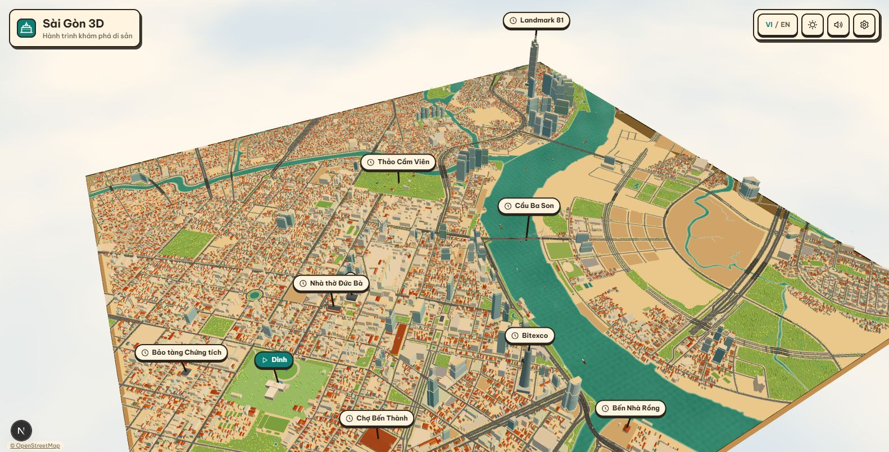
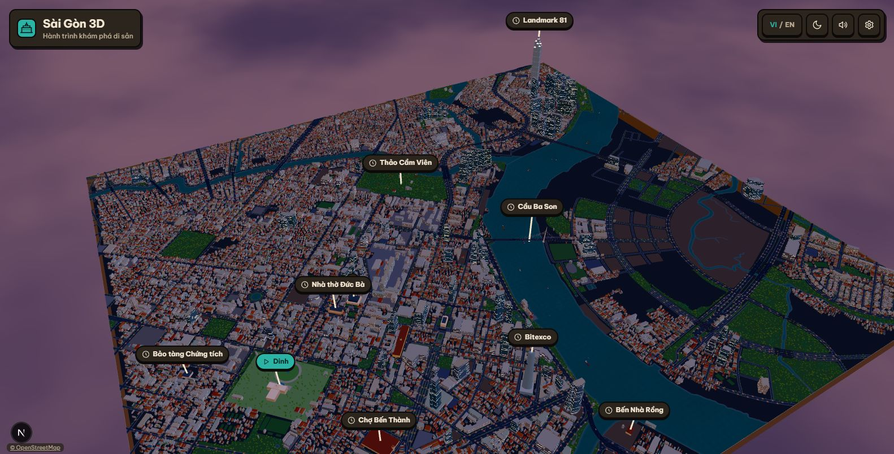
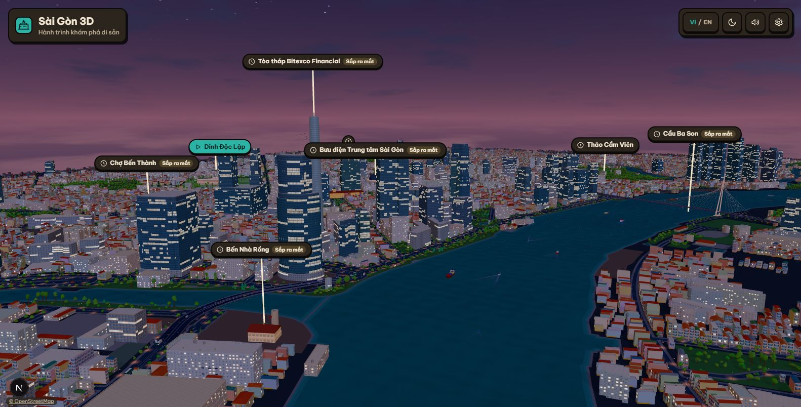
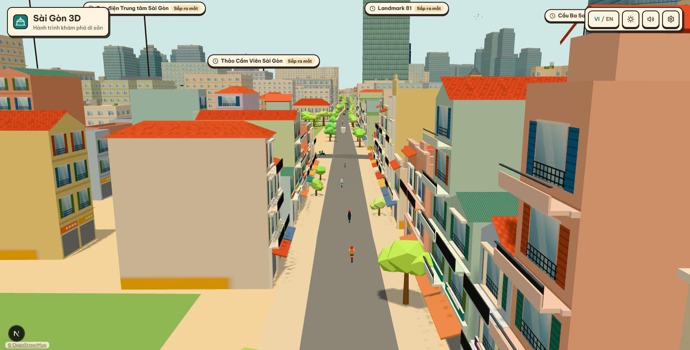
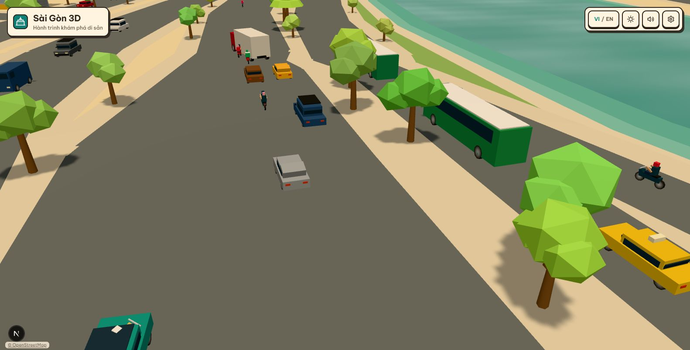
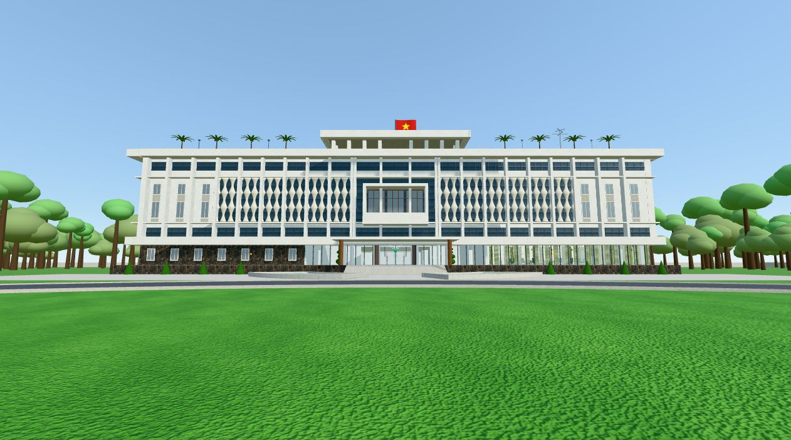
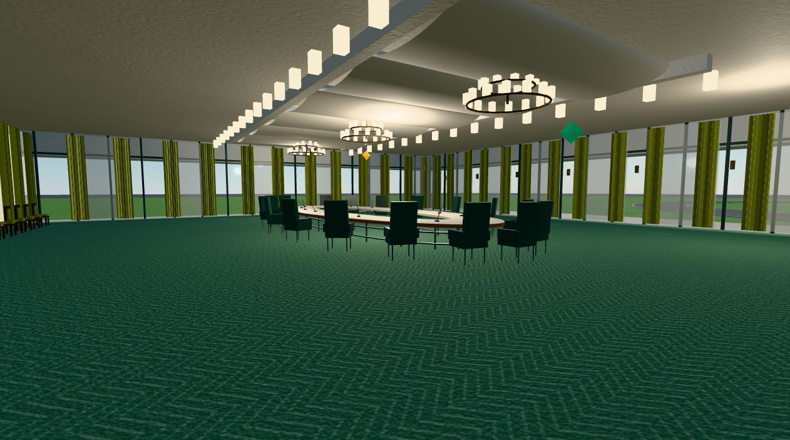
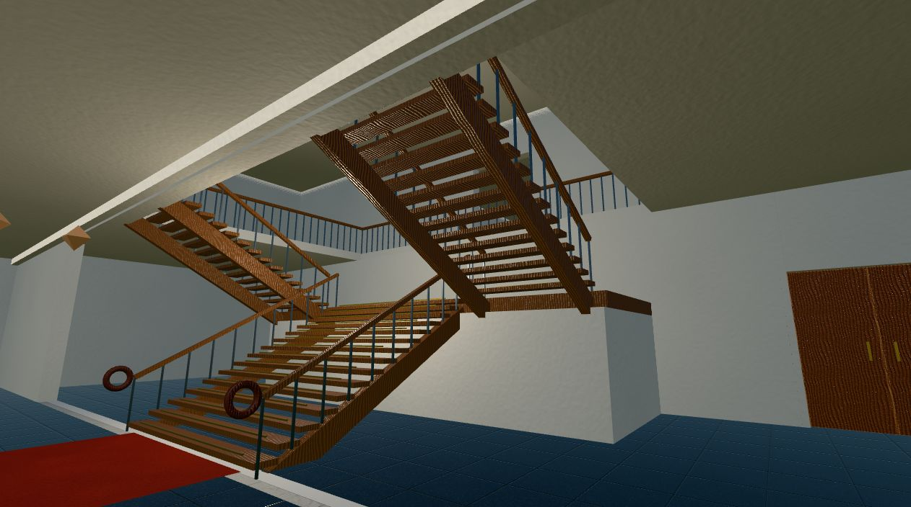
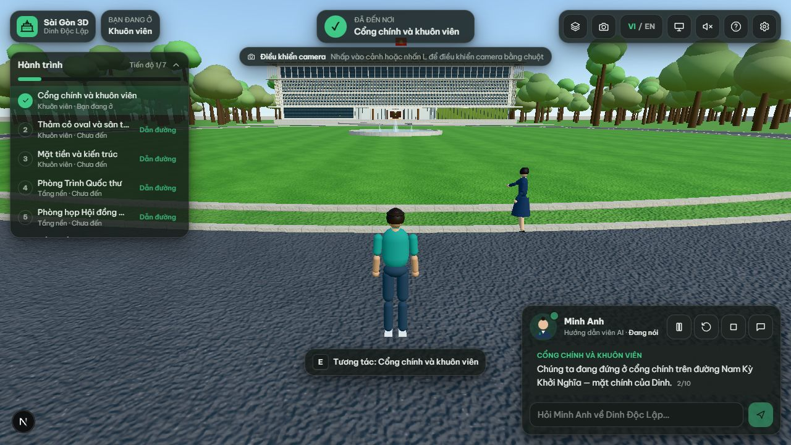
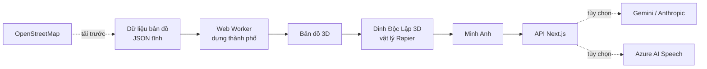

# Sài Gòn 3D

**Saigon 3D — Immersive Heritage Explorer**

Khám phá trung tâm TP. Hồ Chí Minh trên một sa bàn 3D sống động dựng từ dữ liệu bản đồ thật,
rồi đi bộ tham quan **Dinh Độc Lập** cùng hướng dẫn viên AI **Minh Anh**, ngay trên trình duyệt.

[Giới thiệu](#giới-thiệu) · [Ảnh chụp](#ảnh-chụp) · [Tính năng](#tính-năng) · [Kiến trúc](#kiến-trúc) · [Độ chính xác](#độ-chính-xác-lịch-sử) · [Tài liệu](#tài-liệu)

## Giới thiệu

**Sài Gòn 3D** là ứng dụng web du lịch số cho di sản TP. Hồ Chí Minh, gồm hai không gian:

- **Bản đồ thành phố.** Sa bàn 3,9 × 3,6 km từ Quận 1 tới Landmark 81, dựng từ dữ liệu OpenStreetMap, với xe cộ, tàu thuyền, người đi bộ, bầu trời ngày và đêm. Trên bản đồ có 10 địa điểm tiêu biểu.
- **Tham quan Dinh Độc Lập.** Khuôn viên và các phòng bên trong, chia thành 20 không gian, đi bộ được bằng bàn phím và chuột.

Toàn bộ hình 3D và texture được sinh bằng mã ngay trong trình duyệt, không cần cài đặt và không có tệp mô hình tải về.

> **Trạng thái:** Dinh Độc Lập là địa điểm tham quan được. Chín địa điểm còn lại đã có mô hình trên bản đồ và đang ở trạng thái "Sắp ra mắt": Nhà thờ Đức Bà, Bưu điện Trung tâm, Bảo tàng Chứng tích Chiến tranh, Chợ Bến Thành, Bến Nhà Rồng, Thảo Cầm Viên, Landmark 81, Bitexco và Cầu Ba Son.

## Ảnh chụp

| Sài Gòn về đêm | Bờ sông và skyline |
|---|---|
|  |  |
| **Dãy nhà phố** | **Giao thông đường phố** |
|  |  |
| **Mặt tiền Dinh Độc Lập** | **Phòng họp Nội các** |
|  |  |
| **Cầu thang trung tâm** | **Minh Anh thuyết minh** |
|  |  |

## Tính năng

### Bản đồ thành phố

- **Địa lý thật:** đường, sông, công viên và khoảng 4.600 đường bao công trình lấy từ OpenStreetMap; 10 địa điểm đặt đúng tọa độ.
- **Kiến trúc đô thị:** nhà phố Việt Nam với mái ngói, ban công, cửa chớp, tum thang; chung cư, văn phòng và cao ốc giật cấp; mô hình riêng cho từng công trình nổi bật.
- **Giao thông:** 17 loại xe đi theo làn đường thật, có đèn tín hiệu, giữ khoảng cách và giảm tốc khi vào cua; 8 loại tàu thuyền trên sông với vệt sóng phía sau.
- **Ngày và đêm:** nắng sớm, mây, mặt trời; sao, trăng, đèn đường, đèn xe, cửa sổ sáng khác nhau theo loại công trình.
- **Tối ưu theo khung nhìn:** chi tiết chỉ hiện ở những khu vực gần camera và trong khung hình, mờ dần khi ra xa.

### Tham quan Dinh Độc Lập

- **Đi bộ tự do hoặc có dẫn đường:** cửa, cầu thang và va chạm được mô phỏng vật lý; đường đi được vẽ trên sàn.
- **Nạp theo từng phòng:** chỉ phòng đang ở mới chiếm tài nguyên đồ họa, phòng vừa rời được giữ lại để quay về nhanh.
- **Điều khiển:** <kbd>W</kbd> <kbd>A</kbd> <kbd>S</kbd> <kbd>D</kbd> để đi, <kbd>F</kbd> để tương tác, <kbd>M</kbd> mở sơ đồ tầng, <kbd>Enter</kbd> để hỏi. Đổi được phím trong Cài đặt; có điều khiển cảm ứng.

### Hướng dẫn viên AI Minh Anh

- **Dẫn đoàn:** đi trước vài mét, chờ khi bạn tụt lại, thuyết minh khi bạn đến gần.
- **Hỏi đáp có kiểm chứng:** chỉ trả lời từ kho tư liệu có nguồn của dự án, và nói thẳng khi chưa có thông tin đã xác minh.
- **Song ngữ:** tiếng Việt và tiếng Anh, có giọng đọc Azure AI Speech và phụ đề.
- **Không phụ thuộc dịch vụ ngoài:** nếu AI hoặc giọng đọc không khả dụng, ứng dụng vẫn trả lời từ kho tư liệu và hiện phụ đề.

## Kiến trúc

Gần như mọi thứ chạy trên trình duyệt. Máy chủ chỉ giữ khóa dịch vụ và chuyển tiếp yêu cầu tới AI và giọng đọc.

| Lớp | Công nghệ |
|---|---|
| Web | Next.js 16 (App Router), React 19, TypeScript |
| 3D | Three.js, React Three Fiber, Drei, shader tùy chỉnh |
| Vật lý | Rapier |
| Trạng thái, giao diện | Zustand, Tailwind CSS 4, Framer Motion |
| Dịch vụ AI | Google Gemini hoặc Anthropic Claude; Azure AI Speech |
| Kiểm thử | Vitest |

Chi tiết nằm trong [tài liệu kiến trúc hệ thống](docs/KIEN_TRUC_HE_THONG.md).

## Kiểm thử

98 kiểm thử tự động (Vitest), gồm:

- **Thành phố:** không tam giác lộn mặt, cây không đặt trên đường hay nhà, mọi lớp kết thúc đúng tại ranh giới bản đồ.
- **Giao thông:** xe không rời đường và không chồng nhau, không kẹt cứng, tàu luôn ở trên nước.
- **Dinh Độc Lập:** mô phỏng vật lý đi từ cổng lên mái và xuống hầm, không xuyên tường; mọi cửa đi được hai chiều.
- **Minh Anh:** dẫn đường, chờ, nhắc, không đổi trạng thái liên tục.
- **Nội dung:** mọi dữ kiện có nguồn, đủ bản dịch hai ngôn ngữ.

## Độ chính xác lịch sử

Ứng dụng tách rõ điều đã kiểm chứng với điều là ước lượng hoặc minh họa. Mỗi dữ kiện mang một trong bốn mức tin cậy: `verified`, `conflicting`, `estimated`, `simulated`. Toàn bộ nguồn xem tại trang `/sources` của ứng dụng.

| Thành phần | Trạng thái |
|---|---|
| Đường phố, sông, công viên, đường bao công trình | Dữ liệu OSM thật |
| Vị trí các địa điểm trên bản đồ | Tọa độ thật từ OSM |
| Hình dáng và màu sắc nhà trên bản đồ | Sinh tự động, không phải kiến trúc thật |
| Mô hình các địa điểm trên bản đồ | Cách điệu theo hình dáng nhận diện |
| Số liệu khuôn viên và tòa nhà Dinh, vị trí các phòng tầng 1 | Theo [dinhdoclap.gov.vn](https://dinhdoclap.gov.vn/kien-truc-dinh-doc-lap/) |
| Kích thước phòng, chiều cao tầng, bố cục tầng 2 | **Ước lượng**, vì không có mặt bằng đo đạc công khai |
| Tên một số phòng tiếp khách ở tầng 2 | **Chưa xác minh**, dùng tên mô tả |
| Tranh và hoa văn nội thất | Minh họa, không sao chép tác phẩm |
| Xe cộ, tàu thuyền, người đi bộ | Mô phỏng |

Ảnh tư liệu của Di tích không được nhúng lại; ứng dụng dẫn liên kết tới trang nguồn.

## Hướng phát triển

- Mở tham quan cho các địa điểm còn lại.
- Dựng thêm các tầng và phòng của Dinh khi có nguồn xác minh.
- Chia vùng chi tiết cho cây xanh, và đo hiệu năng trên nhiều thiết bị hơn.
- Thêm chuyển làn cho giao thông và cách tìm kiếm tốt hơn cho kho tư liệu.

## Tài liệu

- [Kiến trúc hệ thống](docs/KIEN_TRUC_HE_THONG.md)
- [Nghiệm thu Dinh Độc Lập](docs/BAO_CAO_NGHIEM_THU_DINH_DOC_LAP.md)
- [Nâng cấp giao diện](docs/BAO_CAO_NANG_CAP_GIAO_DIEN_SAIGON3D.md)
- [Nâng cấp bản đồ](docs/BAO_CAO_NANG_CAP_SAIGON_MAP.md)
- [Giao thông và mặt sông](docs/BAO_CAO_GIAO_THONG_VA_MAT_SONG.md)
- [Nhà cửa, màu sắc, ánh sáng đêm](docs/BAO_CAO_NHA_CUA_MAU_SAC_DEM.md)
- [Bầu trời, tối ưu, địa điểm, phạm vi bản đồ](docs/BAO_CAO_BAU_TROI_LOD_LANDMARK.md)

## Nguồn dữ liệu và ghi công

- Dữ liệu bản đồ © [OpenStreetMap contributors](https://www.openstreetmap.org/copyright), giấy phép ODbL 1.0.
- Tư liệu lịch sử và kiến trúc: [Di tích lịch sử Dinh Độc Lập](https://dinhdoclap.gov.vn).
- Danh mục đầy đủ tài sản và giấy phép: `data/assets.ts` và trang `/sources`.

## Giấy phép

Mã nguồn chưa có giấy phép: mọi quyền thuộc về tác giả cho đến khi có file `LICENSE`. Dữ liệu OSM trong `public/data/` tuân theo ODbL 1.0.
