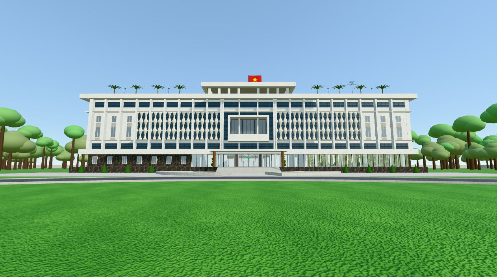
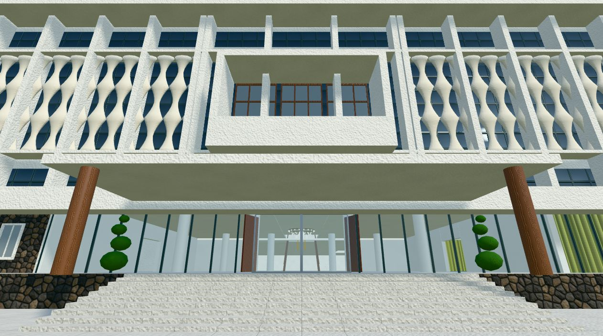
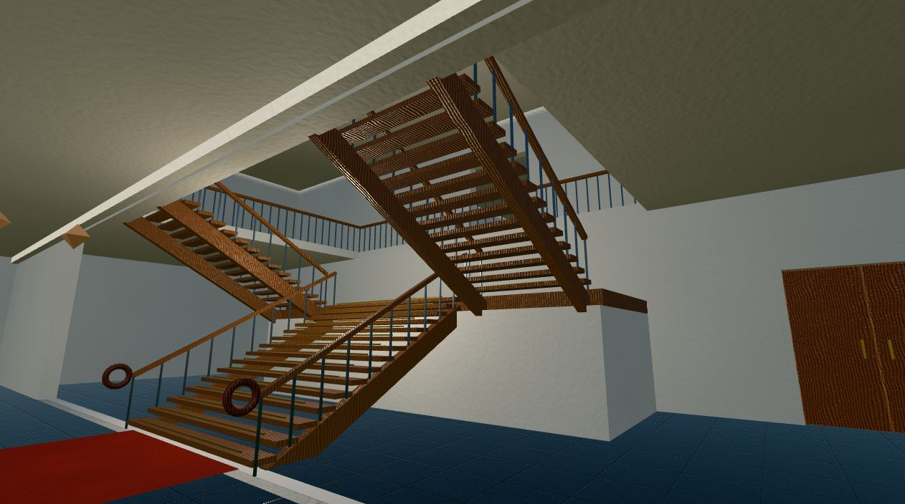
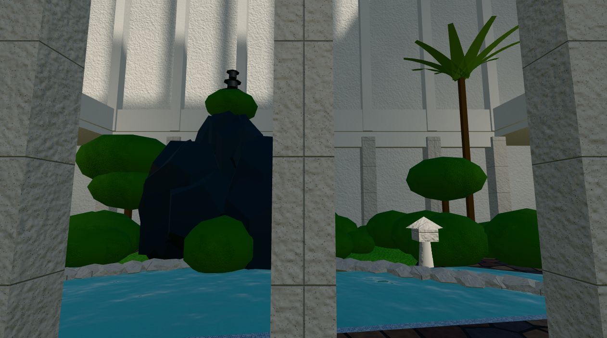
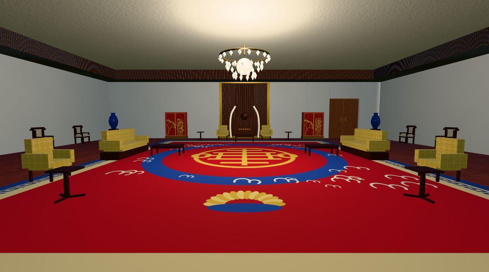
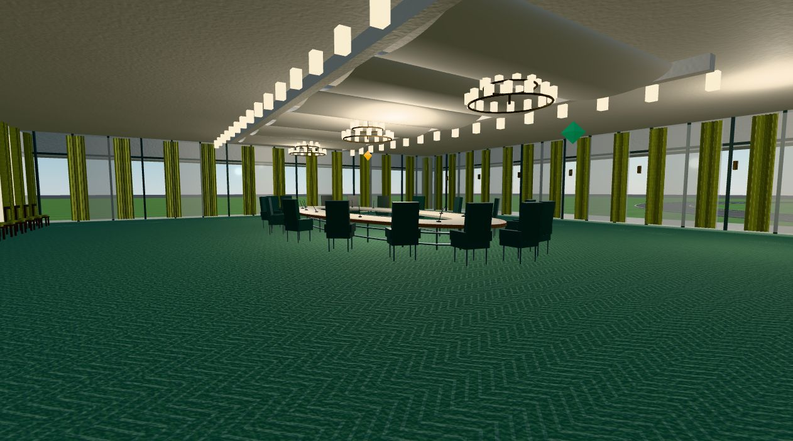
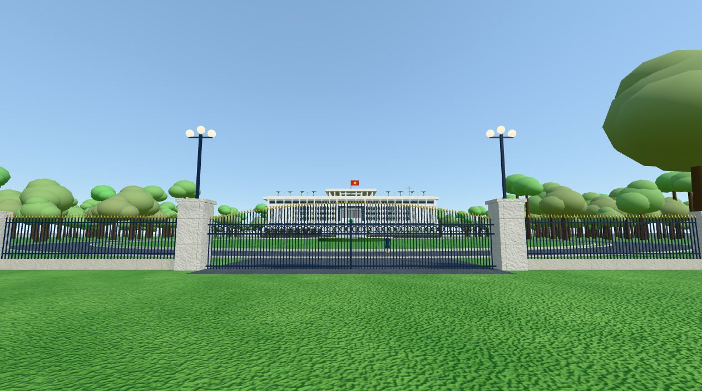
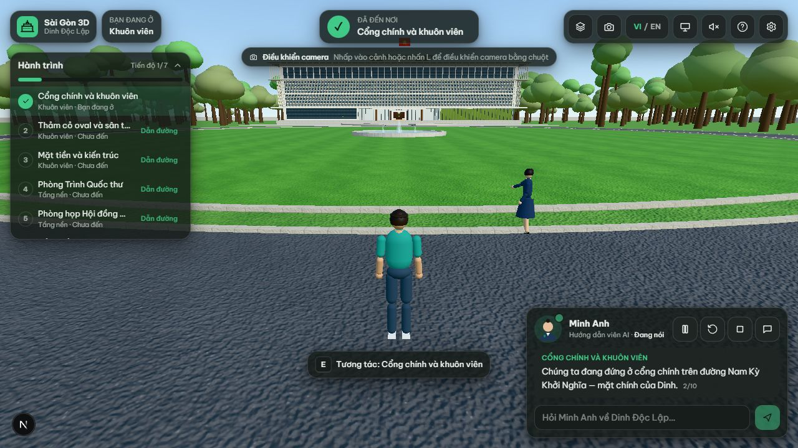
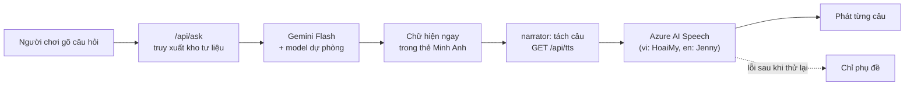

<div align="center">

# 🏛️ Sài Gòn 3D — Du lịch số di sản

**Saigon 3D — Immersive Heritage Explorer**

Bản đồ Sài Gòn 3D dựng từ dữ liệu OpenStreetMap thật, cùng chuyến tham quan **Dinh Độc Lập** đi bộ được trong không gian 3D.
Hướng dẫn viên AI **Minh Anh** dẫn đường, thuyết minh song ngữ và trả lời câu hỏi dựa trên tư liệu đã kiểm chứng.

[](https://nextjs.org)
[](https://react.dev)
[](https://threejs.org)
[](https://www.typescriptlang.org)
[](https://ai.google.dev)
[](https://learn.microsoft.com/azure/ai-services/speech-service/)
[](#-kiểm-thử)
[](https://www.openstreetmap.org/copyright)

[Giới thiệu](#-giới-thiệu) · [Ảnh chụp](#-ảnh-chụp) · [Dinh Độc Lập](#️-dinh-độc-lập-3d) · [Minh Anh](#-hướng-dẫn-viên-ai-minh-anh) · [Kiến trúc](#-công-nghệ--kiến-trúc) · [Độ chính xác](#-độ-chính-xác-lịch-sử)

</div>

---

## 📖 Giới thiệu

**Sài Gòn 3D** là ứng dụng web du lịch số cho di sản TP. Hồ Chí Minh, gồm hai phần:

- **Bản đồ thành phố 3D.**
  - Dựng tự động từ OpenStreetMap vùng trung tâm: Quận 1, Quận 3, bờ sông Sài Gòn, Thủ Thiêm, Bình Thạnh tới Landmark 81.
  - Có đường phố, sông và kênh, công viên, khoảng 4.600 công trình có dữ liệu.
  - Ngoài khung đô thị, đường và sông thật vẫn tiếp tục, còn nhà cửa thưa dần ra vùng đất trống.
  - Xe cộ, thuyền, người đi bộ và chim được mô phỏng.
- **10 địa điểm** trên bản đồ: Dinh Độc Lập, Nhà thờ Đức Bà, Bưu điện Trung tâm, Bảo tàng Chứng tích Chiến tranh, Chợ Bến Thành, Bến Nhà Rồng, Thảo Cầm Viên, Landmark 81, Bitexco và Cầu Ba Son.
- **Dinh Độc Lập đi bộ được.** Gồm khuôn viên, mặt tiền, 20 không gian bên trong ở tầng 1, tầng 2, tầng hầm và sân thượng, dựng theo 90 ảnh tham chiếu đã tuyển chọn và tư liệu của trang chính thức.

> **Trạng thái:** Dinh Độc Lập là điểm được đầu tư hoàn chỉnh. Các địa danh khác trên bản đồ đang ở trạng thái “Sắp ra mắt”.

## 📸 Ảnh chụp

| Mặt tiền Dinh Độc Lập | Rèm hoa đá và bao lơn danh dự |
|---|---|
|  |  |
| **Cầu thang trung tâm chia hai vế** | **Sân trong (giếng trời)** |
|  |  |
| **Phòng Tiếp khách Tổng thống** | **Phòng họp Hội đồng Nội các** |
|  |  |
| **Cổng chính và hàng rào** | **Minh Anh thuyết minh** |
|  |  |

<sub>Ảnh chụp từ ứng dụng trong trình duyệt headless. Một số ảnh đã ẩn giao diện.</sub>

## 🏛️ Dinh Độc Lập 3D

### Các không gian

Dinh được chia thành **20 không gian độc lập**, khai báo trong `data/dinh/spaces.ts`. Mỗi không gian chỉ được dựng khi người chơi ở trong đó (hoặc vừa rời đi) và được giải phóng khi không còn cần.

| Tầng | Không gian |
|---|---|
| Khuôn viên | Cổng và hàng rào, thảm cỏ oval với đài phun nước, hồ sen bán nguyệt, mặt tiền với rèm hoa đá |
| Tầng 1 | Đại sảnh, cầu thang trung tâm, Phòng họp Nội các (bên phải sảnh), Phòng Đại yến (bên trái), Phòng Khánh tiết (sau cầu thang), hành lang cầu thang, sân trong (giếng trời) |
| Tầng 2 | Sảnh tầng 2, Phòng Trình Quốc thư, Phòng Tiếp khách Tổng thống, ba phòng tiếp khách và một phòng làm việc (tên chưa xác minh) |
| Tầng hầm | Hành lang, phòng bản đồ tác chiến, phòng truyền tin |
| Sân thượng | Lầu Tứ phương vô sự, sân đáp với trực thăng UH-1 và hai vòng đỏ đánh dấu chỗ bom rơi |

Vị trí tương đối các phòng tầng 1 theo mô tả của trang chính thức. Kích thước và vị trí cụ thể là ước lượng, vì không có mặt bằng đo đạc công khai.

### Di chuyển giữa các không gian

- **Cửa:** nhấn <kbd>F</kbd> khi có gợi ý. Không gian đích được tải sau màn mờ, rồi người chơi xuất hiện ở phía bên kia cửa.
- **Cầu thang trung tâm:** đi bộ thật. Đi vế giữa lên chiếu nghỉ, rẽ trái hoặc phải theo một vế bên lên tầng 2. Cảnh tự chuyển giữa đại sảnh và sảnh tầng 2 tại chỗ, không teleport.
- **Cầu thang lên sân thượng và xuống tầng hầm:** đi bộ trong giếng thang. Riêng cầu thang sân thượng có lối tắt bằng F, vì ba tầng lầu nó đi qua chưa được mô hình hóa.

### Cách dựng hình

- **Mặt tiền:** đo trên ảnh chụp chính diện, gồm 23 nhịp. Rèm hoa đá được dựng bằng hình học thật (3 hàng đốt trúc). Đầu hồi có phù điêu, bệ ốp đá chẻ.
- **Phòng:** dựng theo nhóm ảnh tham chiếu của chính phòng đó. Danh sách ảnh ghi trong `REFERENCE_PHOTOS`.
- **Texture:** 39 bộ PBR (màu, độ nhám, normal map) sinh bằng mã, ở độ phân giải 1024 px khi chọn chất lượng cao. Thảm, cánh tủ sơn mài và tranh được vẽ trên canvas 2048 px, không lặp hoa văn.
- **Ảnh tham chiếu:** không ảnh nào được dán lên bề mặt. Tranh và họa tiết là hình minh họa đúng chất liệu và kích thước, không sao chép tác phẩm.

Chi tiết từng khu vực, mức xác minh và số liệu đo nằm trong [báo cáo nghiệm thu](docs/BAO_CAO_NGHIEM_THU_DINH_DOC_LAP.md).

## 🤖 Hướng dẫn viên AI Minh Anh

Minh Anh vừa là nhân vật trong thế giới 3D, vừa là trợ lý hỏi đáp.

- **Dẫn đoàn:**
  - đi trước người chơi 2–4 m, đi qua cửa và cầu thang hợp lệ;
  - chậm lại và chờ khi bạn tụt lại, nhắc có chừng mực;
  - thuyết minh khi bạn đến gần, tạm dừng khi bạn đi xa.
- **Trả lời bằng Google Gemini (Flash):**
  - chỉ dựa trên kho tư liệu có nguồn của dự án, đúng ngôn ngữ bạn đang gõ, nhớ ngữ cảnh nhiều lượt;
  - câu hỏi ngoài kho tư liệu được trả lời thẳng là chưa có thông tin đã xác minh;
  - khi AI quá tải, hệ thống chuyển sang model dự phòng hoặc trích nguyên văn từ kho, và ghi rõ chế độ đang dùng.
- **Giọng đọc Azure AI Speech:**
  - tiếng Việt giọng nữ HoaiMy, tiếng Anh giọng nữ Jenny;
  - phát theo từng câu, có phụ đề;
  - lỗi thì thử lại, sau đó chỉ hiện phụ đề.



**Bảo mật và quyền riêng tư:**
- Không lưu hội thoại hay file âm thanh.
- `/api/ask` và `/api/tts` có giới hạn tần suất và kiểm tra dữ liệu đầu vào (zod).

## 🎮 Điều khiển

| Phím | Chức năng |
|---|---|
| <kbd>W</kbd> <kbd>A</kbd> <kbd>S</kbd> <kbd>D</kbd> / mũi tên | Di chuyển (3 m/s) |
| <kbd>Shift</kbd> | Chạy (5,5 m/s) |
| Chuột | Nhìn quanh: nhấp vào cảnh hoặc <kbd>L</kbd> để khóa chuột; không khóa thì giữ chuột và kéo |
| <kbd>F</kbd> | Tương tác khi có gợi ý: đi qua cửa, xem hiện vật, nghe thuyết minh, đóng bảng thông tin |
| <kbd>V</kbd> | Góc nhìn thứ nhất ↔ thứ ba |
| <kbd>Space</kbd> | Nhảy |
| <kbd>M</kbd> | Sơ đồ tầng và chọn điểm đến |
| <kbd>G</kbd> | Gọi Minh Anh lại gần |
| <kbd>Enter</kbd> | Hỏi Minh Anh |
| <kbd>H</kbd> | Ẩn/hiện hướng dẫn |
| <kbd>Esc</kbd> | Mở khóa chuột; nhấn lần nữa để tạm dừng và vào cài đặt |

Mọi phím (trừ Esc) đổi được trong phần Cài đặt. Thiết bị cảm ứng có cần điều khiển ảo.

## 🧱 Công nghệ & kiến trúc

**Công nghệ:** Next.js 16 (App Router) · React 19 · Three.js + React Three Fiber + drei · Rapier (vật lý) · Zustand · Framer Motion · Tailwind CSS 4 · zod · Vitest.

```
app/                   / (bản đồ), /dinh-doc-lap (tham quan), /sources · API: /api/ask, /api/tts, /api/status
components/
  map/                 CityScene, các lớp thành phố, OutskirtsLayer, LivingCity (xe, thuyền, người, chim)
  game/                DinhScene (Canvas + Rapier), Palace (không gian, vật liệu, các phòng tầng 1 và tầng hầm),
                       PalaceExterior (mặt tiền, đài phun nước, mái), PalaceRoomsF2 (phòng tầng 2, giếng trời), RouteGuide
  player/ guide/ tour/ Nhân vật, Minh Anh, giao diện tham quan
data/dinh/             layout, rooms2 (kích thước, nội thất), spaces (không gian, cửa, ảnh tham chiếu),
                       interactions (cửa F, lối đi bộ), tour, knowledge, sources
lib/
  dinh/                palaceModel (hình + va chạm + đồ thị đi bộ từ một nguồn), spaceModel (tách theo không gian),
                       route (tìm đường), textures (PBR sinh bằng mã)
  world/streaming.ts   Tải, kích hoạt, cache và giải phóng không gian
  interaction/         Chọn điểm tương tác, chạy chuyển cảnh qua cửa
  tour/                director (thuyết minh, cửa, chuyển cảnh khi đi bộ), navigator (dẫn đường giữa các không gian)
  city/ sim/           Dựng thành phố trong Web Worker, mô phỏng giao thông và sự sống
  server/ audio/       Gemini/Claude, Azure TTS, giới hạn tần suất · phát theo câu và phụ đề
scripts/               fetch-osm.mjs, fetch-outskirts.mjs
tests/                 Vitest
docs/                  Báo cáo nghiệm thu, ảnh chụp
```

**Nguyên tắc thiết kế:**

- **Một nguồn cho hình, va chạm và đường đi.** `palaceModel` sinh khối hiển thị, collider, đồ thị đi bộ và vật cản (kể cả nội thất) từ dữ liệu bố cục. Người chơi, Minh Anh và bộ tìm đường vì vậy cùng thấy một thế giới.
- **Mỗi không gian độc lập.** Một không gian chỉ mang hình học, va chạm, nội thất, đèn và đồ thị đi bộ của chính nó. Cầu thang trung tâm thuộc chung hai không gian (`sharedRegions`), để đi bộ qua lại liền mạch.
- **Kiến thức nằm trong dữ liệu.** Mỗi câu thuyết minh dựa trên một `Fact` có nguồn và mức tin cậy (`verified` / `estimated` / `simulated` / `conflicting`).
- **Tách hành vi khỏi hiển thị.** Tìm đường và trạng thái của Minh Anh là mã thuần, được kiểm thử độc lập.

## ⚡ Hiệu năng

Số liệu đo trên GPU tích hợp Intel UHD Graphics (Chrome, ANGLE D3D11, 1280×800, chất lượng cao):

| Khu vực | FPS | Draw call |
|---|---|---|
| Ngoài trời | ≈ 61 | 301 |
| Đại sảnh và cầu thang | ≈ 102 | 166 |
| Phòng họp Nội các | ≈ 85 | 208 |
| Phòng tầng 2 | ≈ 92 | 108–113 |

- Mỗi phòng tải lần đầu trong 80–610 ms.
- Có 3 mức đồ họa: Thấp / Trung bình / Cao.
- Chưa đo trên GPU rời và thiết bị di động.

## 🧪 Kiểm thử

92 kiểm thử tự động (Vitest), gồm:

- **Kho tri thức:** toàn vẹn dữ liệu, nguồn, i18n, truy xuất câu trả lời.
- **Vật lý:** capsule Rapier đi theo các tuyến đã lập; tường và nội thất chặn được.
- **Tìm đường:** mọi cạnh của đồ thị đi bộ không xuyên vật cản; tuyến chỉ đổi tầng qua cầu thang.
- **Không gian và cửa:** mỗi cửa đi được hai chiều, điểm xuất hiện nằm trên sàn của không gian đích, đồ thị kết nối giữa các không gian, tải và giải phóng.
- **Minh Anh:** dẫn trước, chờ, nhắc có giới hạn, không rung trạng thái, chỉ thuyết minh đúng lúc.
- **Thành phố:** mặt đường hướng lên, xe không chồng nhau, thuyền luôn trên nước, địa danh và vùng ngoại vi đúng vị trí.

## 📚 Độ chính xác lịch sử

Ứng dụng tách rõ điều đã kiểm chứng với điều là ước lượng hoặc mô phỏng. Toàn bộ nguồn xem tại trang `/sources`.

| Thành phần | Trạng thái |
|---|---|
| Đường phố, sông, công viên, đường bao công trình | Dữ liệu OSM thật (ODbL) |
| Kiểu kiến trúc và màu từng công trình trên bản đồ | Sinh tự động, không phải kiến trúc thật |
| Khuôn viên 120.000 m², thảm cỏ đường kính 102 m, khối nhà 4.500 m², cao 26 m, rèm hoa đá quanh lầu 2, hồ sen bán nguyệt | Theo [dinhdoclap.gov.vn](https://dinhdoclap.gov.vn/kien-truc-dinh-doc-lap/) |
| Vị trí tương đối các phòng tầng 1 | Theo mô tả của trang chính thức |
| Phòng Tiếp khách Tổng thống ở tầng 2: hai tủ sơn mài Mai Lan Cúc Trúc, ghế Tổng thống trước tấm gỗ tượng trưng quốc kỳ | Theo trang chính thức |
| Hai vòng đỏ trên sân đáp đánh dấu chỗ bom rơi ngày 8/4/1975, trực thăng UH-1 trên sân thượng | Theo trang chính thức |
| Kích thước phòng, chiều cao tầng, vị trí phòng tầng 2, giếng trời, bố cục cầu thang | **Ước lượng** (không có mặt bằng đo đạc công khai) |
| Tên các phòng tiếp khách nhóm ảnh 12–14 | **Chưa xác minh**, dùng tên mô tả |
| Tranh, hoa văn cánh tủ, bản đồ trong hầm | Minh họa, không sao chép tác phẩm |
| Tuyến xe, tàu thuyền, người đi bộ | Mô phỏng |

Ảnh tư liệu của Di tích không được nhúng lại; ứng dụng dẫn liên kết tới trang nguồn.

## 🚧 Giới hạn & hướng phát triển

- Các tầng lầu 3 trở lên và nhiều phòng (trong đó có Phòng chiếu phim / Giải trí) chưa được dựng, vì thiếu nguồn xác minh vị trí và bố cục.
- Nhân vật, cây và trực thăng là mô hình dựng bằng mã, mức chi tiết vừa phải. Có thể thay bằng mô hình GLB có giấy phép.
- Giọng nói phụ thuộc hạn mức của Azure. Khi hết hạn mức, câu trả lời vẫn hiển thị đầy đủ dưới dạng phụ đề.
- Chưa có lip-sync và chưa có nhập câu hỏi bằng giọng nói.

## 🙏 Nguồn dữ liệu & ghi công

- Dữ liệu bản đồ © [OpenStreetMap contributors](https://www.openstreetmap.org/copyright), giấy phép ODbL 1.0.
- Tư liệu lịch sử và kiến trúc: [Di tích lịch sử Dinh Độc Lập — dinhdoclap.gov.vn](https://dinhdoclap.gov.vn).
- Giọng đọc: [Azure AI Speech](https://learn.microsoft.com/azure/ai-services/speech-service/). AI: [Google Gemini API](https://ai.google.dev).

Danh mục đầy đủ tài sản và giấy phép nằm trong `data/assets.ts` và trang `/sources`.

## 📄 Giấy phép

Chưa chọn giấy phép cho mã nguồn: mọi quyền thuộc về tác giả cho đến khi có file `LICENSE`. Dữ liệu OSM trong `public/data/` tuân theo ODbL 1.0.
