# Báo cáo nâng cấp giao diện và đồ họa Sài Gòn 3D

Ngày: 30/10/2026. Căn cứ: `PROMPT_CLAUDE_SAIGON3D_VISUAL_UI.md` và 7 ảnh tham chiếu (gọi theo thứ tự gửi: 01 CityRT, 02 toàn cảnh ven nước, 03 đi bộ trong xóm, 04 bản đồ mưa có HUD, 05 modal, 06 cận cảnh phố, 07 bảng Sinh hoạt).

**Phạm vi đã giữ nguyên:**
- tọa độ và dữ liệu địa lý, khung đô thị, landmark;
- mô hình và texture Dinh Độc Lập;
- scene manager, room registry, phím WASD/F;
- Minh Anh, Guided Tour, chuyển cảnh.

Không thêm cơ chế game (tiền, dân số, thời tiết, xe máy, nhiệm vụ). Không dùng tên, logo hay nội dung của sản phẩm tham khảo.

## 1. Ảnh tham chiếu đã áp dụng vào đâu

| Ảnh | Đã dùng cho | Cố ý không dùng |
|---|---|---|
| 01 CityRT (nhỏ) | Bố cục chung: thanh công cụ dưới, cụm nút trên, thành phố chiếm phần lớn màn hình | Chỉ số dân, tiền, nhu cầu, các nút xây dựng |
| 02 Toàn cảnh ven nước | Bảng màu bản đồ: sông xanh ngọc trầm, mái ngói đất nung, tường kem/cát/xanh xô thơm/xanh ngọc nhạt, cỏ xanh dịu, ánh sáng mềm, bóng đổ rõ | Biển bao quanh, đảo, núi: Sài Gòn giữ đúng địa lý |
| 03 Đi bộ trong xóm | HUD đi bộ trong Dinh: thẻ "Dinh Độc Lập / khu vực · Đi bộ tham quan" góc trên trái; cụm nút và nút "Về bản đồ" góc trên phải; gợi ý tương tác dạng thẻ có phím teal; bảng "Điều khiển" thu gọn được góc dưới trái | Phím E (nói chuyện), R (lên xe máy): giữ nguyên F và các phím hiện có |
| 04 Bản đồ mưa có HUD | Thanh công cụ dưới có viền mái hiên sọc teal; các thẻ HUD kem viền đậm, bóng lệch | Tiền, dân số, lịch, thời tiết, nhiệm vụ |
| 05 Modal | Modal và hộp thoại (Cài đặt, chọn cách tham quan, tạm dừng): nền kem, viền nâu đậm, bóng lệch màu mù tạt, tiêu đề đậm, nút chính teal, nút phụ kem; Segmented và Toggle cùng kiểu | Nội dung Xomtopia (chọn bản đồ, làng mới, tài khoản) |
| 06 Cận cảnh phố | Chi tiết nhà: gờ tầng nhô ra, ban công có lan can trên mặt tiền dài, chậu cây và vườn trên mái, cùng các chi tiết đã có (bồn nước, mái tôn/ngói, mái hiên, biển hiệu) | Tượng đài, cột cờ ngẫu nhiên: không thêm vật thể không có trong dữ liệu |
| 07 Bảng Sinh hoạt | Menu tạm dừng: cột mục bên trái (Tạm dừng / Cài đặt / Trợ giúp), nội dung bên phải, tự xếp dọc trên điện thoại; thẻ địa điểm trên bản đồ có phần đầu, thân cuộn riêng và chân có nút hành động | Mini-game, hộp mù, đơn hàng |

## 2. File đã thêm hoặc sửa

| File | Thay đổi | Ảnh hưởng |
|---|---|---|
| `app/globals.css` | Bộ token mới cho cả giao diện sáng và tối: kem `#F5E9D4`/`#FFF4DF`, mực `#2B241D`, teal `#0F7F76`, mù tạt `#DDB85E`, đỏ gạch `#B94537`, mint; bóng lệch cho panel, modal và nút. Thêm các lớp `.panel` (viền 2,5 px, không còn kính mờ), `.panel-modal`, `.btn-game` (bóng ép xuống khi bấm), `.chip`, `.kbd` (phím teal), `.title-game` | Mọi màn hình dùng token: không mã màu lặp trong component |
| `components/ui/primitives.tsx` | Button, IconButton, Modal, Segmented, Toggle, StatusBadge theo kiểu nút game | Giữ nguyên API |
| `components/ui/TopControls.tsx` | Nút ngôn ngữ kiểu game. Nút giao diện, âm thanh, trợ giúp ẩn trên điện thoại (vẫn có trong Cài đặt) | Hết tràn ngang trên màn hình 390 px |
| `components/map/HomeExperience.tsx` | HUD bản đồ mới: thẻ thương hiệu, sidebar địa điểm đóng/mở được, thẻ địa điểm bên phải, thanh công cụ dưới với 6 chức năng có sẵn (Địa điểm, Đến Dinh Độc Lập, Góc nhìn ban đầu, Nguồn tư liệu, Trợ giúp, Cài đặt); nhãn landmark dạng pill viền mực | Không có nút chết; giữ nguyên chọn, bay tới, đi vào Dinh |
| `components/game/DinhExperience.tsx` | HUD đi bộ theo ảnh 03; bố trí lại cho điện thoại | Giữ nguyên phím, khóa chuột, tạm dừng |
| `components/tour/Overlays.tsx` | Hộp chọn cách tham quan theo ảnh 05; menu tạm dừng theo ảnh 07 | Giữ nguyên chức năng |
| `components/tour/NavHud.tsx`, `components/guide/GuideCard.tsx`, `components/tour/InfoPanel.tsx`, `components/ui/WebGLGate.tsx` | Bỏ nền đen trong suốt và viền mảnh, dùng chip và nút game | — |
| `data/i18n.ts` | 3 chuỗi mới (`toolbar`, `backToMapShort`, `walkingMode`), có cả tiếng Việt và tiếng Anh | — |
| `lib/city/architecture.ts` | Bảng màu dịu theo ảnh 02/06; thêm `floorLedges` (gờ tầng), `balconies` (ban công có lan can trên mặt tiền dài nhất), `roofGarden` (chậu cây trên mái) cho chung cư và văn phòng | Chỉ thêm hình khối trên dữ liệu có sẵn |
| `lib/city/buildCity.ts`, `lib/city/outskirts.ts` | Màu mặt nước `#4C9EA0`, cỏ và công viên xanh dịu, nhựa đường xám than | Không đổi hình học hay tọa độ |
| `components/map/CityScene.tsx`, `components/map/CityLayers.tsx` | Nền trời, sương mù, hemisphere light, ambient, nắng ấm hơn, exposure 1,0 | Ánh sáng mềm, không còn mặt đất trắng chói |
| `docs/screenshots/ui/*` | Ảnh trước/sau | — |

Không sửa: `components/game/Palace*.tsx`, `lib/dinh/*`, `data/dinh/*`, `lib/world/*`, `lib/interaction/*`, `lib/tour/*`, controller, camera, Minh Anh.

## 3. Ảnh trước / sau

Cùng góc camera, Chrome headless chạy ANGLE D3D11 trên Intel UHD Graphics, 1440×860, giao diện sáng.

| | Trước | Sau |
|---|---|---|
| Bản đồ tổng quan | 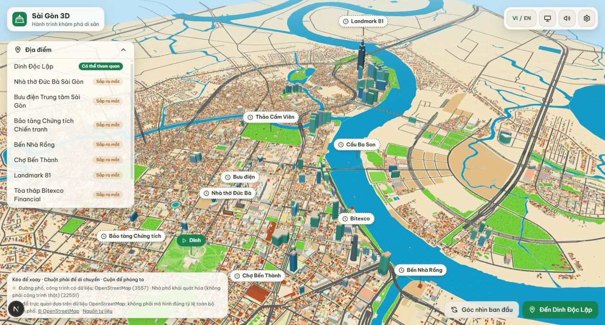 | 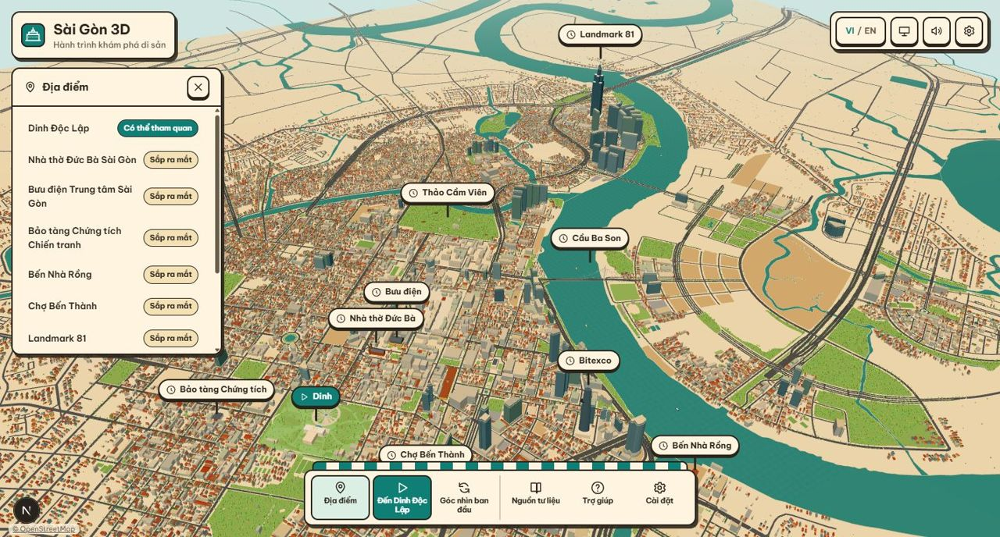 |
| Bản đồ cận cảnh (Chợ Bến Thành) | 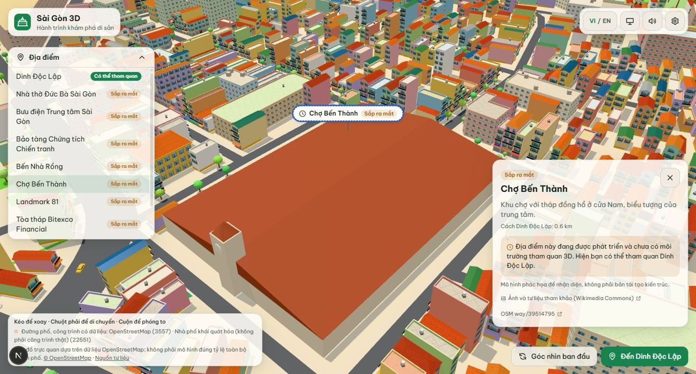 | 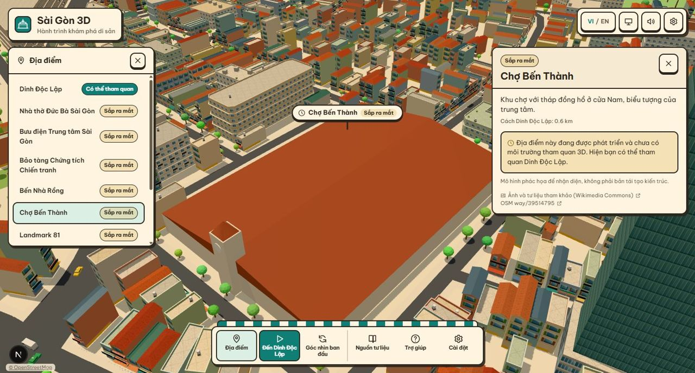 |
| Modal Cài đặt | 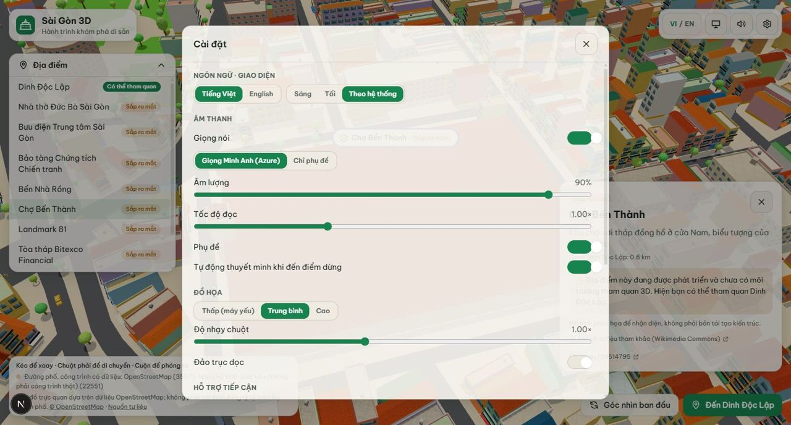 | 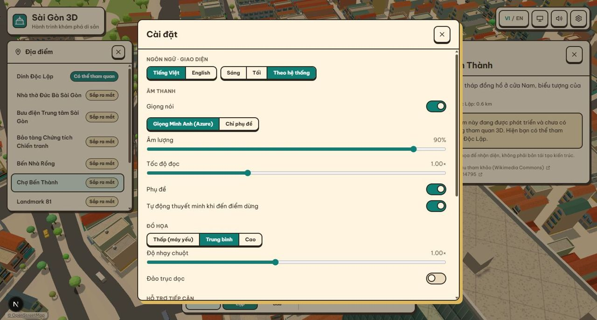 |

**Ảnh sau trong Dinh:**

| Hộp chọn cách tham quan | HUD đi bộ (gợi ý F tại cửa chính) | Menu tạm dừng |
|---|---|---|
| 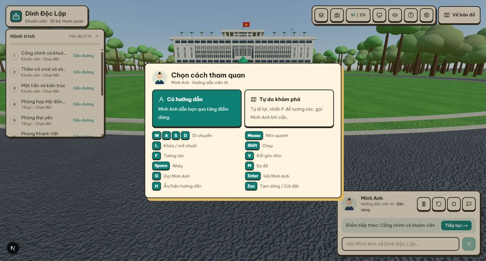 | 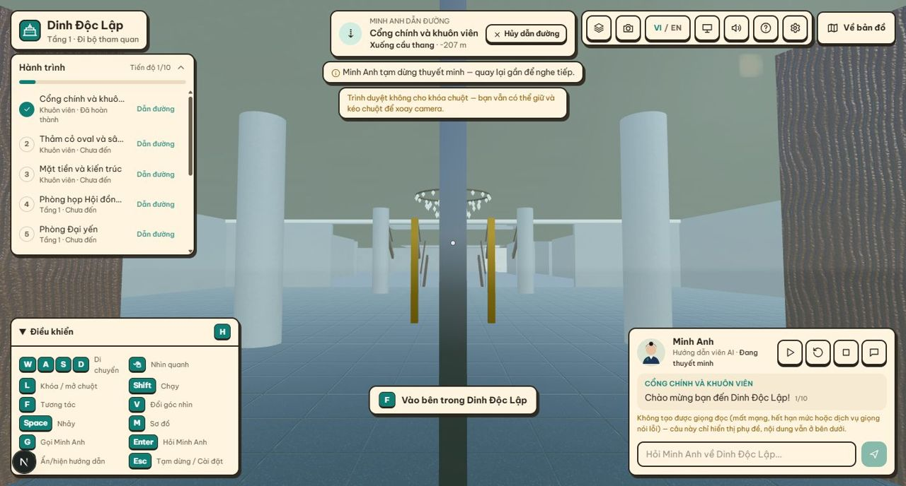 | 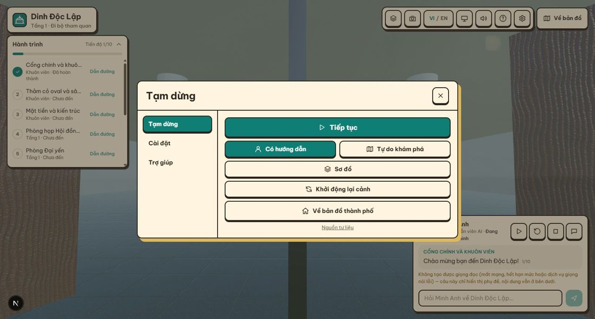 |

Ảnh trước của HUD Dinh trong lượt này không được chụp riêng. HUD cũ có thể xem ở `docs/screenshots/guide-explaining.jpg`.

**Điện thoại (390×844):**

| Bản đồ | HUD đi bộ |
|---|---|
| 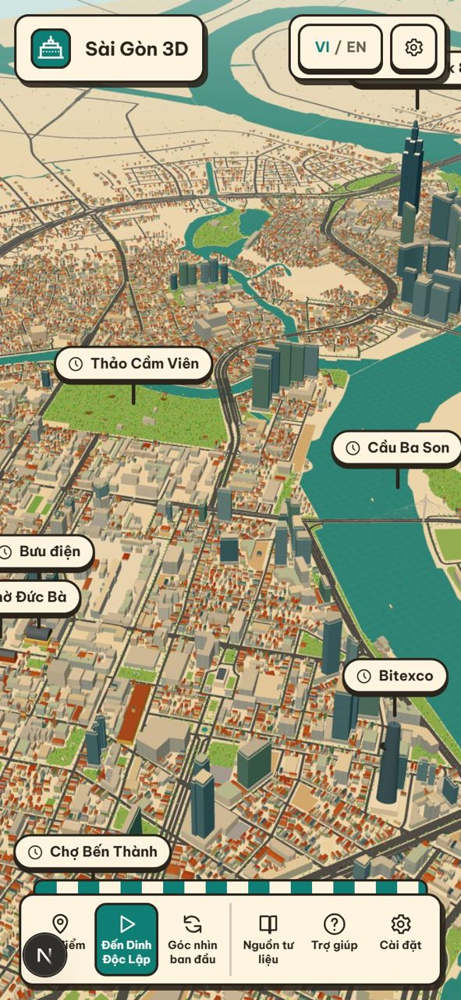 | 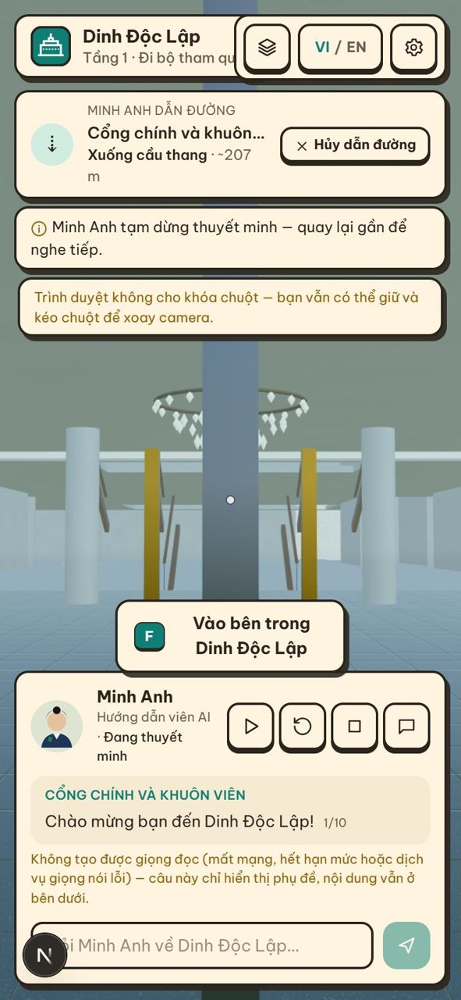 |

## 4. Kiểm thử hồi quy

Đánh dấu ✅ là đã chạy thật. Các mục chưa chạy được ghi rõ.

- ✅ **Bản đồ:**
  - dựng thành phố;
  - chọn địa điểm từ danh sách, máy quay bay tới;
  - thẻ địa điểm, đóng thẻ;
  - nút Góc nhìn ban đầu, Trợ giúp, Cài đặt.
- ✅ **Địa lý:** không đổi tọa độ, khung đô thị, landmark hay hình học đường/sông. Chỉ đổi màu và ánh sáng.
- ✅ **Bản đồ → Dinh:** bấm "Bắt đầu tham quan", cảnh Dinh tới hộp chọn chế độ sau khoảng 25 s trên GPU này.
- ✅ **Cửa F:** hall → Nội các → hall; sảnh tầng 2 → Phòng Tiếp khách Tổng thống → sảnh; Khánh tiết → hành lang → giếng trời. Nhân vật xuất hiện đúng điểm khai báo (lệch 0 m).
- ✅ **Cầu thang đi bộ:** tự chuyển hall ↔ f2_lobby theo cả hai chiều.
- ✅ **Tải và giải phóng:** sau 10 lần chuyển có 8 lần giải phóng, cache tối đa 1 không gian.
- ✅ **Gợi ý tương tác:** hiện "[F] Vào bên trong Dinh Độc Lập" đúng ở cửa chính.
- ✅ **Điện thoại 390×844:**
  - Thanh công cụ và cụm nút không còn tràn.
  - Gợi ý F không còn đè thẻ Minh Anh.
  - Chồng thông báo không còn che thẻ khu vực.
- ✅ **Hydration:**
  - đã gặp một lỗi do máy chủ dev giữ bản `i18n` cũ;
  - sau khi khởi động lại thì không còn lỗi;
  - chuỗi phụ đề đã gộp thành một nút văn bản.
- ⚠️ **Chưa kiểm thử bằng tay:**
  - âm thanh và giọng Minh Anh (chỉ thấy thông báo "không tạo được giọng đọc" do môi trường headless);
  - khóa chuột thật (headless không cấp pointer lock);
  - thao tác chạm thật trên điện thoại;
  - độ phân giải 1920×1080 và 1366×768 (chỉ chụp 1440×860 và 390×844).

## 5. Kết quả kiểm tra và hiệu năng

| Kiểm tra | Kết quả |
|---|---|
| `tsc --noEmit` | Sạch |
| `eslint .` | Sạch |
| `vitest` | 92/92 đạt |
| `next build` | Thành công |

**FPS bản đồ:**
- **Môi trường đo:** Intel UHD Graphics (0x4626), Chrome headless dùng ANGLE D3D11, 1440×860.
- **Cách đo:** mỗi phiên bản 3 lần, đếm `requestAnimationFrame` trong 5 s. Phiên bản "trước" là `architecture.ts` gốc lấy tạm bằng `git stash` rồi khôi phục, nên phần chênh lệch đo được chỉ do gờ tầng, ban công và vườn trên mái.

| Góc nhìn | Không thêm chi tiết nhà | Có gờ tầng, ban công, vườn mái |
|---|---|---|
| Tổng quan | 21,3 / 18,3 / 19,7 (TB 19,8) | 20,7 / 19,6 / 21,0 (TB 20,4) |
| Cận cảnh Dinh | 16,4 / 17,7 / 18,6 (TB 17,6) | 17,0 / 17,1 / 16,7 (TB 16,9) |

- **Kết luận:** chênh lệch nằm trong mức dao động đo.
- **Mức nền thấp:** bản đồ chỉ khoảng 17–21 FPS trên GPU tích hợp này, vì thành phố sống động và hơn 26.000 công trình; đây là mức nền có sẵn, không do lượt này gây ra.
- **Đã giảm chi phí:** gờ tầng tối đa 4 mỗi nhà, bỏ qua cạnh ngắn hơn 4 m. Ban công chỉ trên mặt tiền dài nhất, tối đa 8 mỗi nhà, và chỉ dựng khi chi tiết được bật.
- **Chưa đo:** bộ nhớ GPU (trình duyệt không có API), GPU rời, thiết bị di động thật.

## 6. Phần còn thiếu và việc tiếp theo

- **Mức chi tiết nhà:** nhà vẫn dùng texture mặt tiền vẽ bằng mã cộng hình khối mới. Chưa có khung cửa sổ 3D, chưa có LOD riêng cho chi tiết mới (chi tiết bật theo mức chất lượng như trước).
- **Landmark:** mô hình Chợ Bến Thành trên bản đồ vẫn là khối mái lớn đơn giản. Theo yêu cầu, không thêm chi tiết ngẫu nhiên lên landmark.
- **Hiệu năng bản đồ:** cần tối ưu riêng trên máy yếu (ví dụ giảm số xe và người ở chất lượng thấp). Việc này ngoài phạm vi lượt này.
- **Giao diện tối:** đã có token tương ứng nhưng chưa chụp đối chiếu.
- **Ảnh 01:** quá nhỏ, chỉ dùng để tham khảo bố cục.
